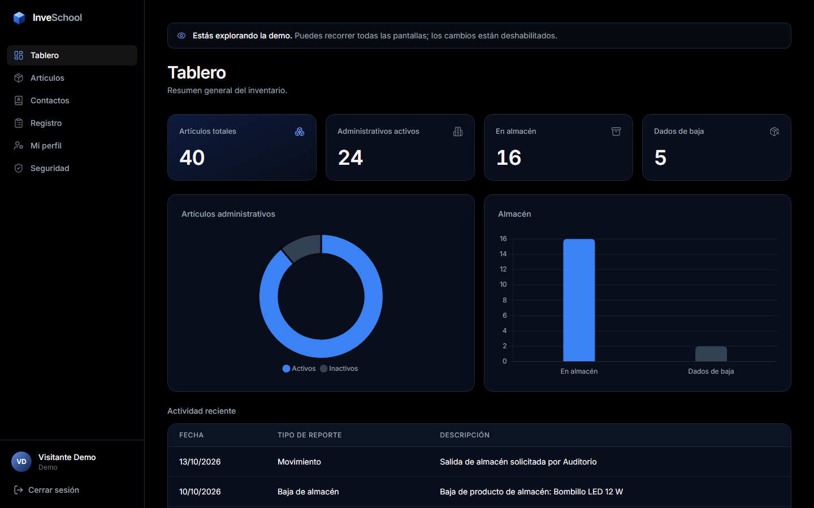
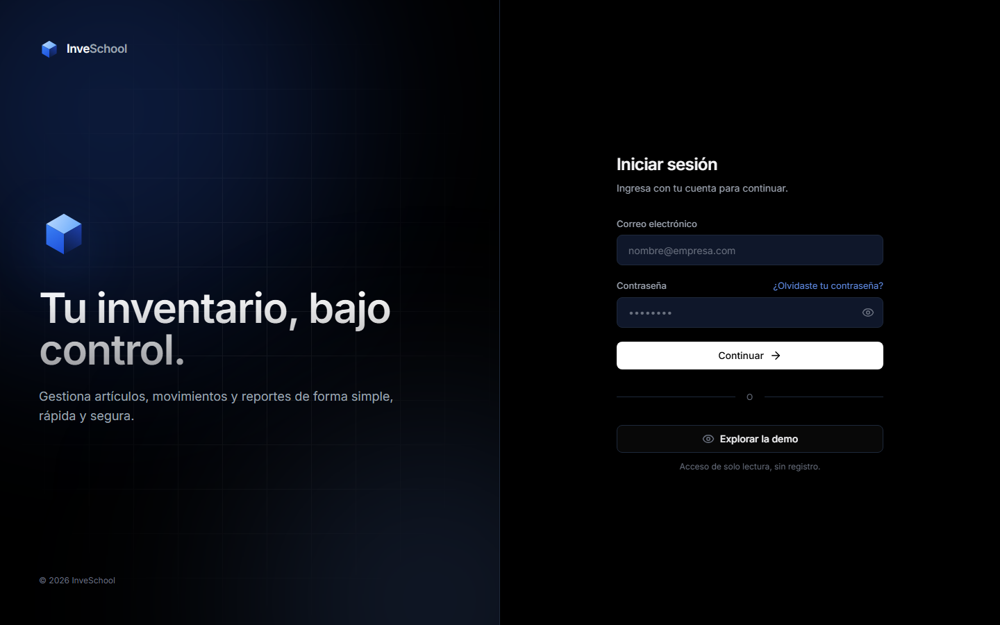
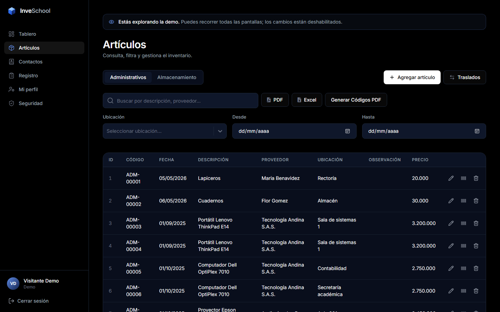
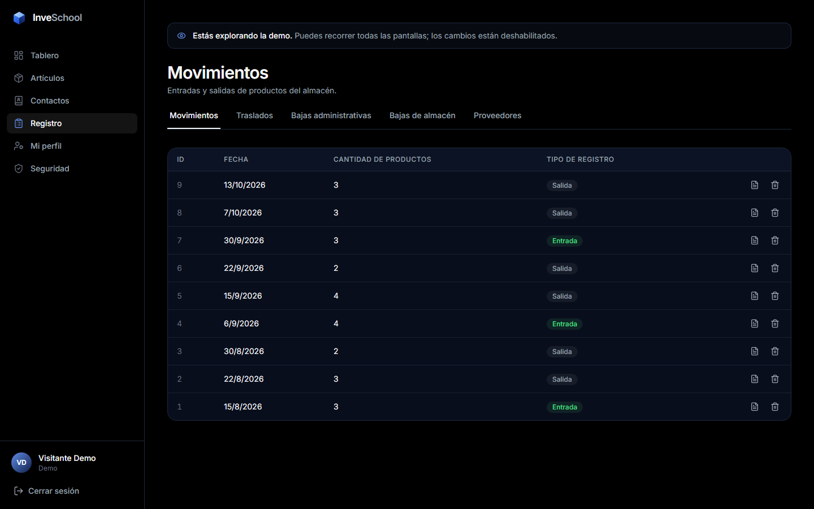
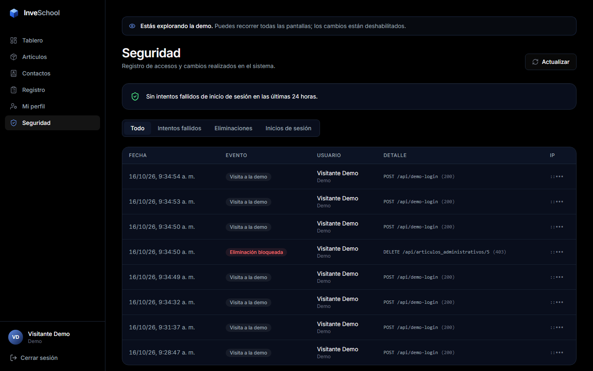
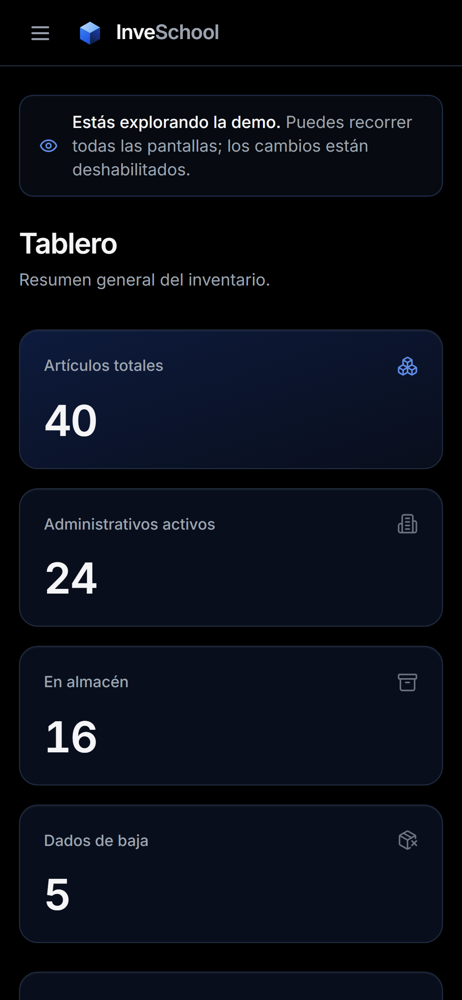
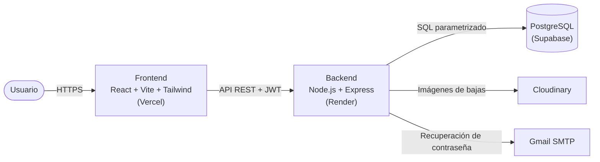

<div align="center">


# InveSchool

**Sistema web de gestión de inventario para instituciones educativas.**
Artículos, almacén, traslados, bajas y reportes, con seguridad de nivel profesional.

[**🚀 Ver demo en vivo**](https://frontend-phi-five-52.vercel.app/demo) · [Características](#características) · [Seguridad](#seguridad) · [Arquitectura](#arquitectura) · [Instalación](#instalación-local)

[](https://github.com/YuranyRivera/InveSchool/actions/workflows/ci.yml)


</div>

> **Prueba la demo sin registrarte:** el enlace entra directo en modo de **solo lectura**. Puedes recorrer todas las pantallas; el servidor bloquea cualquier cambio.
> El backend usa el plan gratuito de Render, así que la primera carga puede tardar hasta un minuto.



## Características

| Módulo | Qué hace |
|---|---|
| **Tablero** | Indicadores del inventario, gráficos y actividad reciente. |
| **Artículos administrativos** | Alta, edición en línea, búsqueda, filtros por ubicación y fecha, códigos `ADM-00001` automáticos. |
| **Almacén** | Control de stock con entradas, salidas y cantidad disponible por producto. |
| **Traslados** | Historial de movimientos de activos entre ubicaciones; la ubicación del artículo se actualiza sola. |
| **Bajas** | Registro de bajas con motivo y evidencia fotográfica (Cloudinary). |
| **Reportes** | Exportación a **PDF** y **Excel**, códigos de barras (CODE128) y estadísticas por proveedor. |
| **Usuarios y roles** | Administrador, Recursos Humanos, Administrativo y Almacenamiento, con permisos distintos. |
| **Bitácora de seguridad** | Quién hizo qué, cuándo y desde qué IP, con alertas de intentos de acceso fallidos. |

<table>
  <tr>
    <td></td>
    <td></td>
  </tr>
  <tr>
    <td></td>
    <td></td>
  </tr>
</table>

<p align="center"><br /><sub>Diseño responsive: funciona en celular, tablet y escritorio.</sub></p>

## Seguridad

La seguridad se aplica **en el servidor**: el frontend nunca es la última línea de defensa.

- **Autenticación JWT** (HS256) con emisor, audiencia y tipo de token verificados; las sesiones expiran.
- **Control de acceso por roles**: cada ruta de la API exige sesión y, cuando aplica, un rol específico. Solo un Administrador puede crear otros administradores.
- **Contraseñas con bcrypt** (12 rondas) y política mínima validada en el backend.
- **Protección contra fuerza bruta**: límite de intentos de inicio de sesión y de recuperación de contraseña por IP.
- **Recuperación de contraseña segura**: enlaces de un solo uso que vencen en 30 minutos; la respuesta no revela si un correo está registrado.
- **Base de datos cerrada**: Row Level Security en todas las tablas y sin permisos para los roles públicos de Supabase. Todas las consultas están parametrizadas (sin inyección SQL).
- **Cabeceras HTTP de seguridad** (Helmet en la API y Content-Security-Policy, HSTS y X-Frame-Options en el frontend) y **CORS** limitado a dominios exactos.
- **Subida de archivos segura**: solo imágenes JPG, PNG o WEBP de hasta 5 MB, guardadas con nombres aleatorios.
- **Auditoría**: cada creación, modificación, eliminación e inicio de sesión queda registrado, incluidos los intentos rechazados.
- **Secretos fuera del código**: configuración validada al arrancar; si falta un secreto o es débil, el servidor no inicia.
- **Demo pública aislada**: el rol *Demo* es de solo lectura en el servidor y ve correos e IP enmascarados.

## Arquitectura



**Frontend:** React 18, React Router 7 (con carga diferida por página), Tailwind CSS con un sistema de diseño propio (tokens de color en variables CSS), Chart.js, jsPDF y SheetJS.
**Backend:** Express organizado en módulos de dominio; cada petición protegida pasa por autenticación → bitácora → modo demo → roles → controlador. Helmet y express-rate-limit.
**Base de datos:** PostgreSQL con triggers para códigos automáticos, historial de bajas y actividad reciente.

### Estructura del proyecto

El frontend sigue una arquitectura **por funcionalidades** (*feature-based*): todo lo de un dominio (páginas, componentes y hooks) vive junto, y lo compartido está en `components/`. El backend usa **módulos de dominio**, cada uno con su controlador y sus rutas.

```
InveSchool/
├── Backend/
│   ├── src/
│   │   ├── app.js                  # Configuración de Express (sin levantar el servidor)
│   │   ├── server.js               # Punto de entrada
│   │   ├── config/                 # env (validado al arrancar), database, mailer, cloudinary
│   │   ├── middlewares/            # authenticate, audit, demo-mode, security, upload, error-handler
│   │   ├── modules/                # Un módulo por dominio: <dominio>.controller.js + <dominio>.routes.js
│   │   │   ├── auth/  users/  audit/  dashboard/  suppliers/
│   │   │   └── administrative-articles/  storage-articles/  transfers/  disposals/  stock-movements/
│   │   ├── routes/index.js         # Une los módulos: rutas públicas y protegidas
│   │   └── utils/validation.js     # Reglas compartidas (correo, contraseñas, roles)
│   └── database/                   # schema.sql, migrations/ idempotentes, seeds/, migrate.js
├── Frontend/
│   └── src/
│       ├── app/                    # App.jsx (enrutador) y routes.js (todas las URLs)
│       ├── components/             # Compartidos: ui, form, feedback, layout, data-display, export, brand
│       ├── features/               # auth, dashboard, inventory, records, users, profile, security
│       │   └── <feature>/          #   pages/ · components/ · hooks/ (· context/)
│       ├── lib/                    # apiClient (fetch con token), notify (toasts), barcode
│       ├── constants/  theme/  styles/
│       └── main.jsx
├── docs/screenshots/
└── docker-compose.yml              # Levanta backend + frontend con un comando
```

### Convenciones

- **Nombres en inglés** para carpetas, archivos, componentes y funciones; la interfaz está en español porque es para usuarios hispanohablantes.
- **Frontend:** componentes en `PascalCase.jsx` (el nombre del archivo es el del componente), hooks `useCamelCase.js`, importaciones con el alias `@/` en lugar de rutas relativas.
- **Backend:** archivos en `kebab-case` con sufijo por responsabilidad (`*.controller.js`, `*.routes.js`, `*.service.js`).
- **Rutas centralizadas:** ninguna URL se escribe a mano; se usa `ROUTES` de `src/app/routes.js`.
- Los nombres de tablas, columnas y endpoints de la API están en español para mantener la compatibilidad con los datos existentes.

## Calidad del código

- **Integración continua** con GitHub Actions: en cada push se ejecutan el linter, el build del frontend, las pruebas del backend y una auditoría de dependencias.
- **Pruebas automáticas** del backend con el *test runner* nativo de Node (`npm test`): autenticación, roles, modo demo y validaciones.
- **ESLint** sin errores en el frontend (`npm run lint`) y **0 vulnerabilidades conocidas** en las dependencias.
- **Code splitting**: cada página se descarga solo al visitarla (carga inicial ~190 KB).

## Instalación local

**Requisitos:** Node.js 18 o superior y una base de datos PostgreSQL (por ejemplo, un proyecto gratuito de Supabase).

```bash
git clone <url-del-repositorio>
cd InveSchool
```

**Backend**

```bash
cd Backend
npm install
cp .env.example .env      # completa DATABASE_URL y genera un JWT_SECRET
npm run db:migrate        # crea las tablas, triggers y reglas de seguridad
npm run db:seed           # opcional: datos de ejemplo y usuario de demo
npm run dev               # API en http://localhost:4000 (src/server.js)
```

**Frontend**

```bash
cd Frontend
npm install
echo "VITE_API_URL=http://localhost:4000" > .env.local
npm run dev               # App en http://localhost:5173
```

**Con Docker** (opcional), desde la raíz del proyecto:

```bash
docker compose up --build   # frontend en http://localhost:8080, API en http://localhost:4000
```

<details>
<summary><b>Variables de entorno del backend</b></summary>

| Variable | Descripción |
|---|---|
| `DATABASE_URL` | Cadena de conexión de PostgreSQL. |
| `JWT_SECRET` | Secreto para firmar sesiones (mínimo 32 caracteres aleatorios). |
| `CORS_ORIGINS` | Dominios del frontend autorizados, separados por coma. |
| `FRONTEND_URL` | URL pública del frontend (enlaces de los correos). |
| `MAIL_USER` / `MAIL_PASS` | Cuenta de Gmail y contraseña de aplicación para la recuperación de contraseña. |
| `CLOUDINARY_*` | Credenciales de Cloudinary para las imágenes de bajas. |
| `DEMO_ENABLED` | `true` para habilitar la demo pública de solo lectura. |

</details>

## Licencia

Distribuido bajo la licencia [MIT](LICENSE).

## Autoría

Desarrollado por **Sofia Rivera** · [GitHub](https://github.com/SofiaCruz291)
